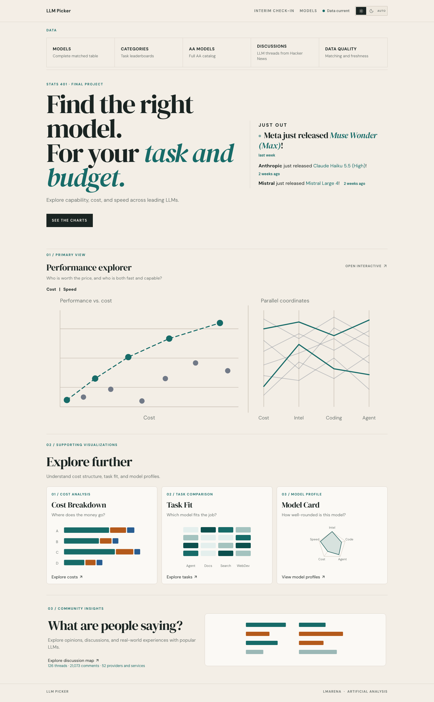

# LLM Picker

**Live site: [https://toothlessos.github.io/llm-picker/](https://toothlessos.github.io/llm-picker/)**

This is a live site, not a frozen demo. The charts, the three newest releases, and the discussion map all read the current database. [Artificial Analysis](https://artificialanalysis.ai/) and [LMArena](https://arena.ai/leaderboard) refresh twice a day, Hacker News refreshes hourly, and the pages pick up a new sync without a redeploy.

[](https://toothlessos.github.io/llm-picker/)

Compare leading language models on capability, cost, and speed, then read what people actually say about them. The picture is the homepage as it stands now. Just out and the discussion counts are read from the current database, so they change when a model ships or a new thread lands. Performance explorer, one click in, draws the current scores, prices, and speeds.

The browser never calls those sources itself. A scheduled job keeps the database current, and every page reads that latest copy.

## What you can do

| Page | Path | What it shows |
|---|---|---|
| Home | `/` | Latest three model releases, and links into the charts |
| Performance explorer | `/visualizations/performance-vs-cost` | Capability against cost or speed. Both views include a scatter, parallel coordinates, and a rank comparison of pinned models |
| Cost breakdown | `/visualizations/cost-per-task` | Where the money in one task goes |
| Task fit | `/visualizations/task-fit` | LMArena ranks for agent, document, search, and webdev |
| Model card | `/visualizations/model-card` | One model against the cohort on intelligence, coding, agentic score, cost, and speed |
| Models | `/models` | Joined table. `/models/:key` is one model |
| Categories | `/categories` | Task leaderboards |
| AA models | `/artificial-analysis` | The full Artificial Analysis catalogue, including rows that did not join |
| Discussions | `/discussions` | Hacker News threads. `/discussions/map` draws one thread as a map |
| Data quality | `/data-quality` | Match coverage and how fresh each source is |

Performance scores come from three different places and are not interchangeable: AA Intelligence Index, AA Coding Index, and the LMArena agent score. Cost and token prices are Artificial Analysis only. LMArena does not publish prices.

## Layout

```
frontend/     React 19, TypeScript, Vite, D3
backend/      Django, Django REST framework, Celery, Redis, SQLite
```

Deeper notes live next to the code:

- [frontend/README.md](frontend/README.md) — routes, the discussion map, and the API client
- [backend/README.md](backend/README.md) — ingest, commands, and configuration
- [backend/docs/api.md](backend/docs/api.md) — the read-only API
- [backend/docs/data-sources.md](backend/docs/data-sources.md) — where each field comes from
- [DEPLOYMENT.md](DEPLOYMENT.md) — GitHub Pages for the frontend, Docker Compose for the API

## Run it locally

You need Python 3.13, [uv](https://docs.astral.sh/uv/), Node.js, npm, and Redis if you want the schedule.

**API** (from `backend/`):

```bash
cd backend
uv sync --group dev
cp .env.example .env          # set AA_API_KEY before the first real refresh
uv run python manage.py migrate
uv run python manage.py refresh_leaderboard --source=all
uv run python manage.py runserver
```

The API is at <http://127.0.0.1:8000/api/v1/leaderboard/>. Leave `AA_API_KEY` blank and the server still starts; only the Artificial Analysis refresh fails. `refresh_leaderboard` is the only step that calls the upstream APIs. A full Artificial Analysis refresh costs several requests against a shared daily quota, so do not loop it.

**Site** (from `frontend/`, in another terminal):

```bash
cd frontend
npm install
npm run dev
```

Open <http://localhost:5173>. The dev server talks to `http://127.0.0.1:8000/api/v1/leaderboard/` unless `frontend/.env` sets `VITE_API_BASE_URL`.

**Scheduled refresh** (optional). Without these, data stays at whatever the last manual refresh wrote.

```bash
redis-server
cd backend
uv run celery -A llm_picker_backend worker -l info
uv run celery -A llm_picker_backend beat -l info
```

Leaderboard sources refresh at 08:00 and 20:00 Asia/Shanghai. Hacker News discussions refresh hourly at minute 15 when `LEADERBOARD_HN_ENABLED` is on. To load discussions once by hand:

```bash
cd backend
uv run python manage.py refresh_discussions
```

## Tests

```bash
cd backend && uv run pytest
cd frontend && npm run test && npm run typecheck
```
