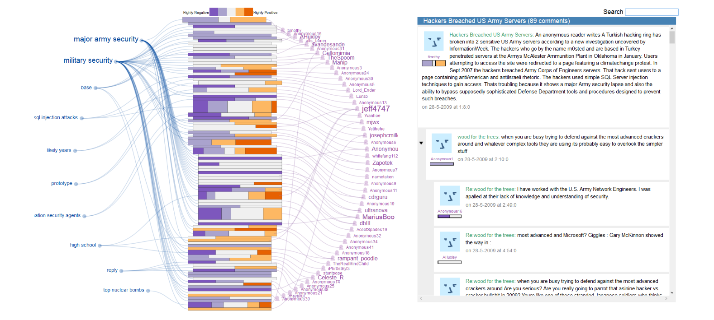

For the visualization, we will refer to the encoding of the [ConVis paper](https://onlinelibrary.wiley.com/doi/full/10.1111/cgf.12378):

# Detailed Designs

1. We follow the same layout as ConVis - thread tree visualization on the left, the reader on the right + the search and filter tool bar on the top.
2. For the thread tree visualization:
    1. Topics of the list of threads on the right - the user can select one of the topics to expand its tree visualization
    2. Encodings that follow ConVis: Use **indentation** to indicate different layers (we can indent a bit more to make it looks clearer, as we don't need the user links in the original ConVis visualization); Use the **height** of "text blocks" to indicate the length of each post.
    3. Encodings that are different: Use **colors** to indicate whether a post /block contains keywords that matches service / provider that the user filters. I need some suggestion from you here - if we assign one color to each filtering constraint, the visualization can become messy. Therefore, I am thinking limiting the number of filters at once (like 5) and only assign colors to the active filters. The search can be simply highlighted with yellow colors.
3. For the reader:
    1. When the user clicks on a thread initially, the reader displays all posts and comments in that thread (just like the regular HN page).
    2. If the user clicks on a block on first layer in the tree, the reader only displays all replies / children of that block (The rest of the tree get dimmed as well).
    3. Similarly, if the user clicks on the other children nodes / blocks, only the replies in that post the it replies to get highlighted.
    4. The block that the user selected always appear on the top of the reader.
    5. Add coordination between the reader and the tree - the selected / current reading post should be highlighted in both the reader and the tree with a thickened border.

Please let me know if the visualization sounds good to you. Feel free the suggest any improvements. Let's finalize the plan together and implement it.

# Where does the visualization go to

The visualization serves as the "People like you" section that are labelled as "coming soon" in the current frontend. We will put it here.