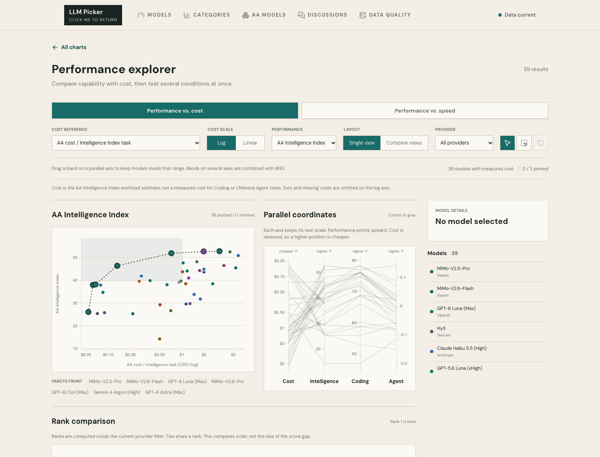
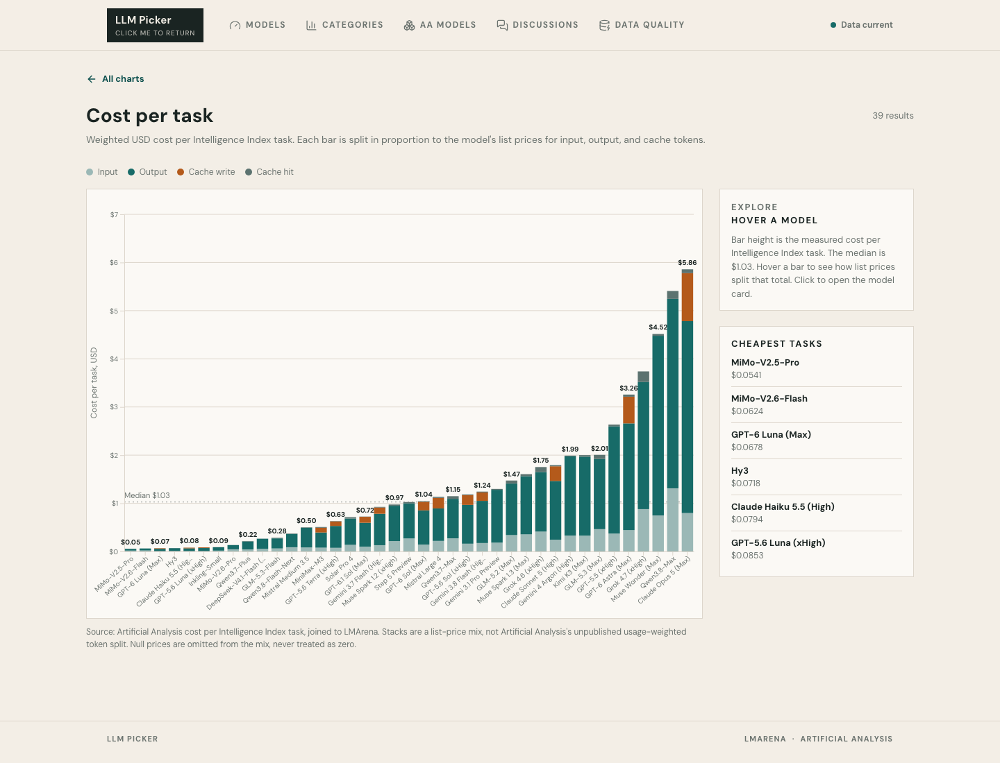
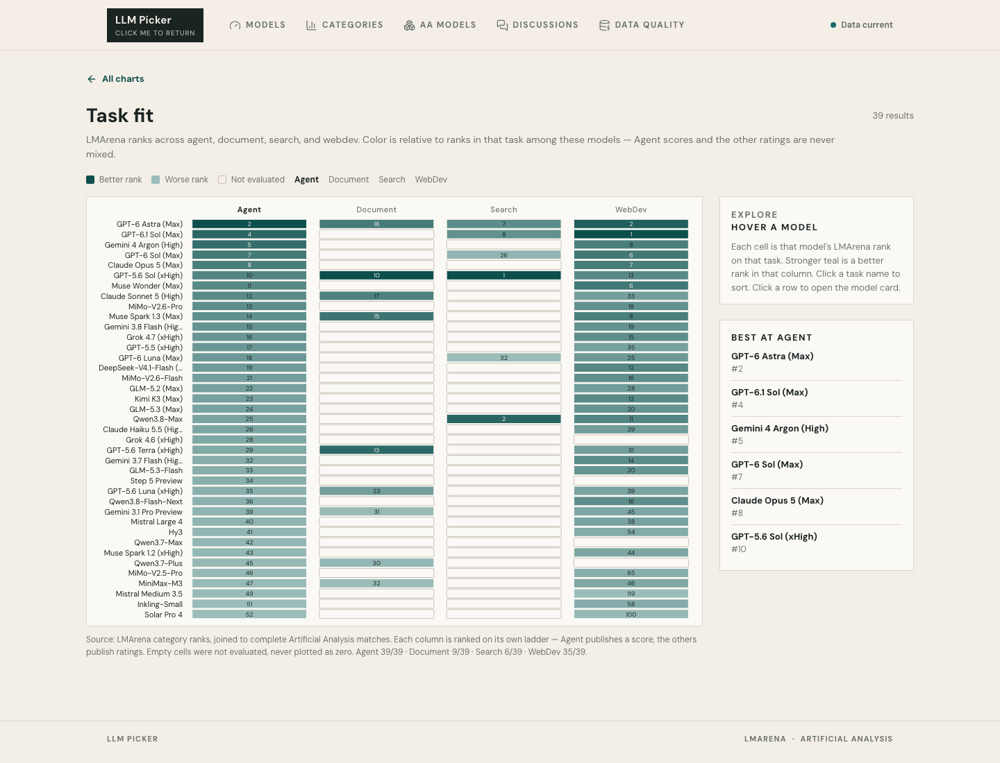
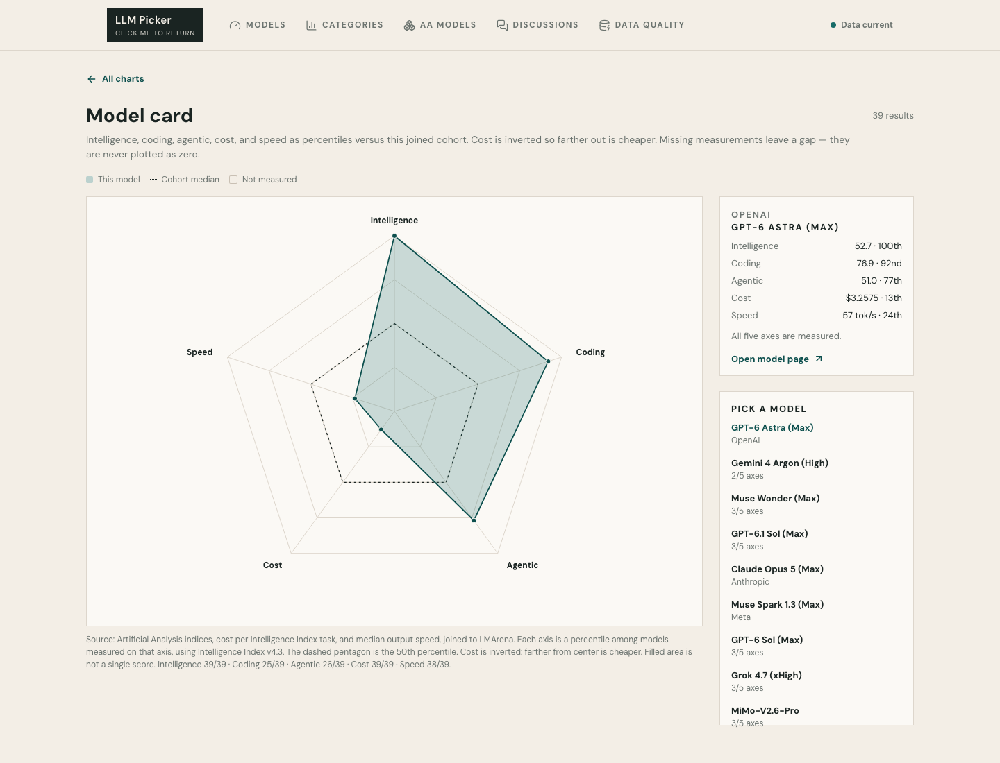
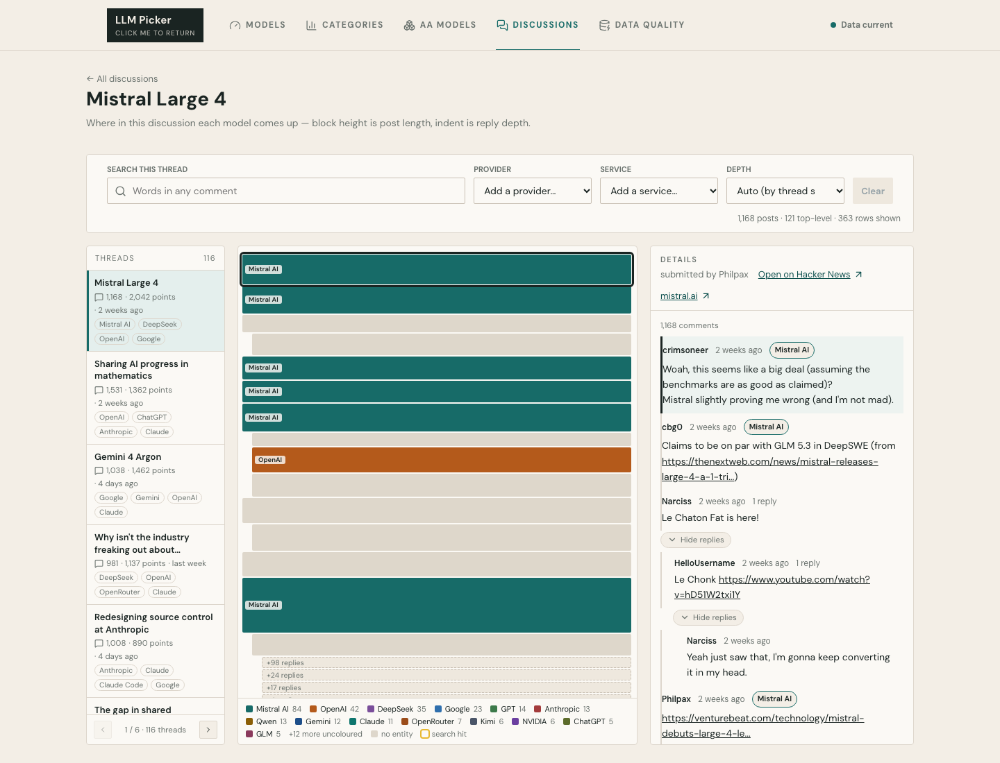

# LLM Picker: Final Report

## Introduction

Choosing a large language model is no longer a simple question of selecting the highest benchmark score. Users must weigh capability against price, latency, task specialization, and evidence from real users. LLM Picker was motivated by this fragmented decision process: benchmark tables, pricing pages, speed measurements, and community discussions exist separately and use incompatible scales. Our project brings them into one exploratory interface for students, developers, researchers, and other LLM users who need to choose a model for a particular task and budget.

The project asks five connected questions: Which models offer the strongest capability–cost trade-off? Which are both fast and capable? How much does an Artificial Analysis Intelligence Index task cost, and what price components shape that cost? Which models are strongest for agent, document, search, or web-development work? Finally, what model- and provider-related themes appear in real community discussions? Visualization is important because no single ranking answers these questions. Position, color, shape, and coordinated interaction let users see trade-offs, missing data, outliers, and multidimensional profiles that would be difficult to infer from a long table. The goal is therefore not to declare one universal winner, but to support comparison and informed choice.

## Method

The project combines three sources. Artificial Analysis (AA) supplies model metadata, Intelligence, Coding and Agentic indices, cost per Intelligence Index task, token prices, median output speed, and time to first token through its paginated v2 API. A full current refresh uses four pages. LMArena data are loaded from the `latest` splits of its Hugging Face leaderboard dataset for agent, document, search, and web-development tasks. Hacker News discussions are discovered through the Algolia API: the pipeline searches a recent time window plus selected LLM terms, applies minimum engagement and relevance rules, then fetches each retained story's nested comment tree. Celery Beat schedules AA/LMArena refreshes at 08:00 and 20:00 and discussion refreshes hourly at minute 15; Redis provides the task queue, rate-limit cache, and overlap locks. Data are stored in SQLite and served through Django REST Framework.

Cleaning is deliberately conservative. AA's UUID is treated as identity because slugs can move between releases; claimed slugs are reconciled before upserts. Monetary values use decimal storage, and upstream nulls remain null rather than becoming misleading zero-cost or zero-latency observations. LMArena names are normalized with Unicode NFKC, case-folding, punctuation-to-hyphen conversion, and reviewed aliases while preserving reasoning-effort variants. WebDev duplicates are collapsed to the best published rank. Agent scores and the other categories' ratings remain separate because their scales are not comparable. Hacker News comments retain parent/child structure; a curated provider/service vocabulary tags mentions without using an unconstrained fuzzy match.

Transformations are calculated for specific visual tasks. Pareto fronts identify non-dominated models: lower cost and higher performance in the cost view, but higher throughput (or lower first-token latency) and higher performance in the speed view. Task ranks are computed within each category, radar axes are cohort percentiles, and the cost axis is inverted so outward consistently means better. The cost stacks allocate measured task cost in proportion to available input, output, cache-write, and cache-hit list prices; they are explicitly presented as an explanatory price mix, not measured token consumption.

The frontend uses TypeScript, React 19, D3 7, SVG, React Query, React Router, HTML, and responsive CSS, built with Vite. D3 implements scales, axes, marks, brushing, and pointer interactions; React owns application and linked-view state. The backend uses Python/Django, with validation, provenance metadata, freshness reporting, and automated tests. Day and night themes use the same semantics with contrast-adjusted colors.

## Results

### 1. Performance Explorer

This coordinated view answers “Which model is worth the price?” and “Which model is both fast and capable?” Users switch between cost and speed, choose Intelligence/Coding/Agent performance, select cost or speed measures, filter providers, and change between log and linear cost scales. The scatterplot encodes cost or speed on *x*, performance on *y*, provider by color, a dashed Pareto front, and a median-based attractive region. Users can pin up to three models, brush a region, or brush ranges on parallel axes; linked marks and the model list update together. A rank-comparison chart shows how pinned models change position across the three performance measures. In the current 39-model cohort, cost spans roughly two orders of magnitude, so several inexpensive models remain Pareto-efficient while the highest-scoring models are not automatically the best-value choices. Speed also forms a separate trade-off: output throughput and first-token delay produce different frontiers and should not be collapsed into one score.

### 2. Cost per Task

This sorted stacked bar chart explains the monetary side of the decision. Bar height is AA's estimated USD cost per Intelligence Index task; segments show the proportional mix of input, output, cache-write, and cache-hit list prices. Hovering reveals values, clicking opens a model page, and legend clicks isolate a component. The median reference line makes comparison immediate. Current costs range from about $0.05 to $5.86 per task, with a median near $1.03. MiMo-V2.5-Pro, MiMo-V2.6-Flash, and GPT-6 Luna are among the cheapest, while several top-end models cost many times the median. The chart therefore reveals that similar benchmark ambitions can have very different operating costs.

### 3. Task Fit

The heatmap asks which model fits a specific job. Rows are matched models, columns are Agent, Document, Search, and WebDev, cell labels are ranks, and darker teal means a stronger rank within that column. Users click a task heading or legend control to sort, hover for the raw score/rating and rank, and click a row to open its model card. Empty cells mean “not evaluated,” not zero. The latest cohort has complete Agent coverage (39/39) and broad WebDev coverage (35/39), but sparse Document (9/39) and Search (6/39) coverage. This missingness is itself an important finding: task-specific recommendations are much more defensible for Agent and WebDev than for Search.

### 4. Model Card

The radar chart summarizes one model across Intelligence, Coding, Agentic, Cost, and Speed. Every axis is a percentile among models measured on that attribute; the dashed polygon is the cohort median, and cost is inverted so farther outward means cheaper. Users choose a model from the list, hover another for comparison, inspect an axis, and follow a link to detailed records. Missing axes remain gaps rather than false zeros. GPT-6 Astra, for example, is at the 100th Intelligence, 92nd Coding, and 77th Agentic percentiles, but only the 13th Cost and 24th Speed percentiles. The uneven shape communicates the central project lesson: exceptional capability can coexist with weak affordability and throughput.

### 5. Discussion Map

The Discussion Map adds community context without reducing comments to a sentiment score. Each block is a comment; horizontal indentation represents reply depth, height represents text length with a cap, and colored bands identify mentioned providers or services. Users select a thread, search comment text, add provider/service filters, choose visible depth, hide unmatched branches, expand compacted subtrees, and click a block to read that branch. The map and reader stay synchronized as reading progresses. In the illustrated Mistral Large 4 thread, 1,168 stored comments form 121 top-level branches, while the automatic depth view reduces them to 363 visible rows. Concentrated Mistral-colored blocks show where discussion stays on the release, while OpenAI, DeepSeek, Google, and other colors reveal comparative sub-conversations.

## Discussion

Using the What–Why–How framework, the **What** includes quantitative attributes (indices, prices, latency, throughput, ranks), categorical attributes (provider, task, entity), and hierarchical text (comment trees). The **Why** is comparison, filtering, trade-off analysis, profile lookup, and exploration of where community attention occurs. The **How** deliberately matches idiom to task: scatterplots and Pareto lines for two-objective optimization; parallel coordinates for conjunctive multivariable filtering; a bump-style rank chart for relative order; stacked bars for part-to-whole cost explanation; a heatmap for model-by-task scanning; a radar chart for one-model profiling; and indented blocks for discussion structure.

The strongest design feature is coordination. Pinning, hover, brushing, filtering, and persistent selections let users move from overview to candidates to detail without losing context. Explicit notes prevent common errors: ranks are not score gaps, log axes omit nonpositive values, task cost is not a personal chat bill, and missing measurements are not zeros. The responsive themes and direct labels also improve accessibility.

Important limitations remain. Cross-source matching reduces the catalogue to a defensible intersection and creates uneven category coverage. Benchmarks and list prices are snapshots, not guarantees for every prompt or deployment. The cost segments estimate proportions from list prices because AA does not publish actual token composition. Radar percentiles depend on the current cohort and filled area is not a valid composite score. Hacker News is a technically oriented, non-representative community; entity mentions show attention, not approval. Future work should add historical trends, uncertainty intervals, user-defined workload/token assumptions, clearer color-accessible palettes, and a transparent recommendation panel that preserves rather than hides the underlying trade-offs.

## Conclusion

LLM Picker shows that model choice is conditional. Some low-cost models sit on the capability–cost frontier; the highest-capability model may be relatively expensive and slow; task leadership changes by category; and community discussion reveals comparison contexts that benchmarks cannot capture. By linking optimization, multidimensional filtering, task evidence, profiles, and discussion structure, the project turns scattered measurements into explorable knowledge. Its contribution is not a single “best model,” but a way for users to identify which evidence matters for their own workload and make a decision whose trade-offs are visible.

## Roles and Responsibilities

- **Siyuan Cao:** data acquisition; backend APIs, refresh/matching infrastructure, deployment, and testing; interface/web development.
- **Ziyue Zhang:** data cleaning and processing; D3 visualization implementation; interaction design, theming, homepage refinement, and the cost/speed performance views.
- **Haoyuan Zheng:** typed frontend API and application-state foundations; interface components, data states, documentation, and presentation/interim materials.
- **All team members:** research questions, analysis, visualization and interaction design reviews, testing feedback, and final presentation preparation.

For the showcase, the clearest live story is: motivation → three data sources → cost Pareto frontier → speed trade-off → task fit → one contrasting model card → a filtered Discussion Map → decision-oriented conclusion. The demonstration should emphasize pinning and linked brushing rather than implementation details.
